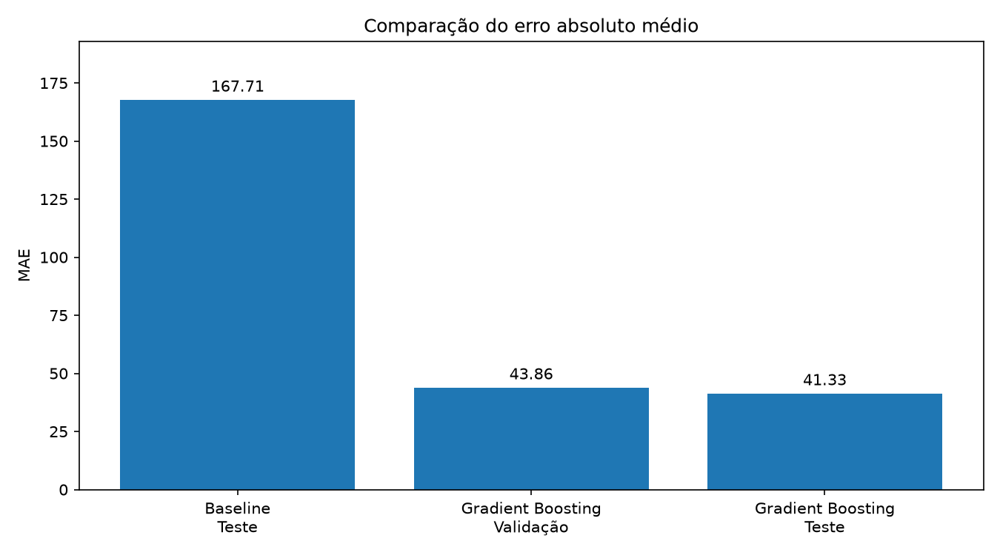
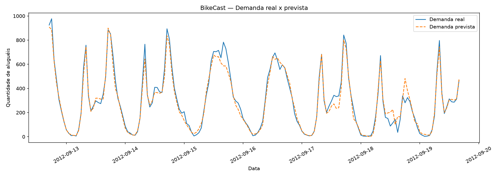
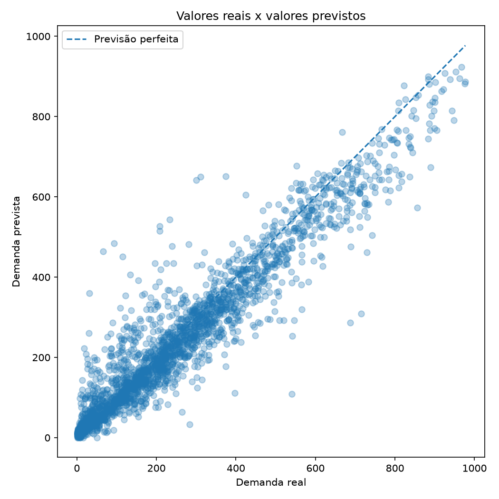
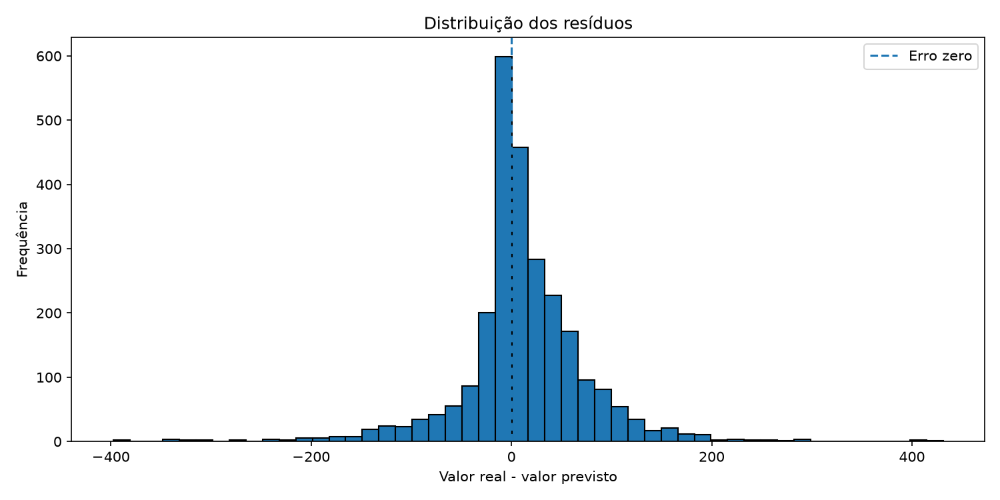
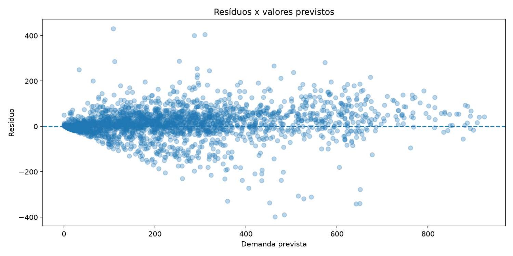
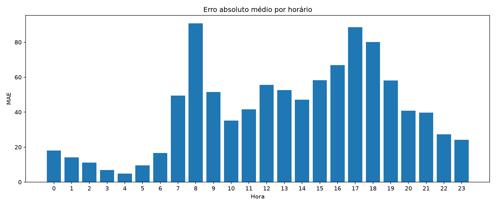
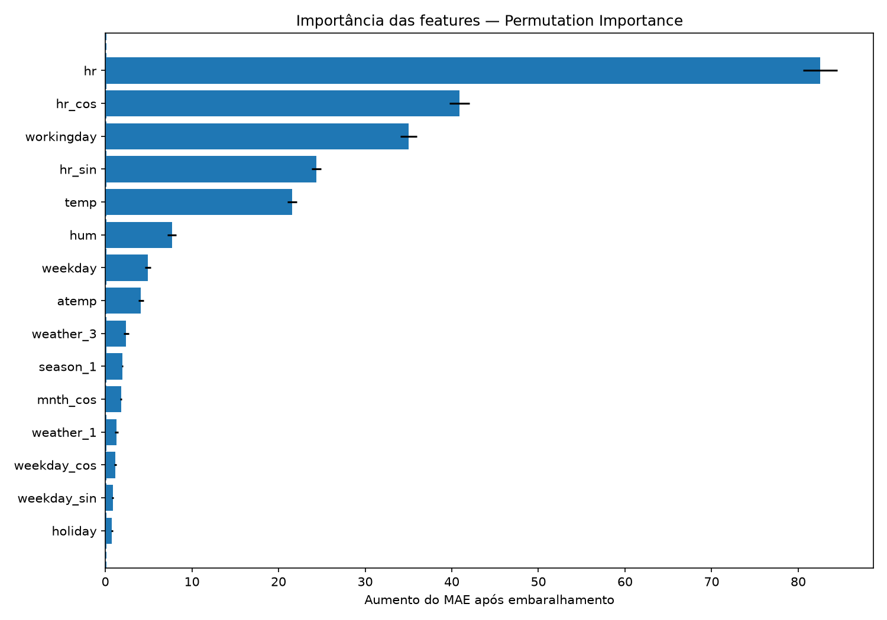

# 🚲 BikeCast

### Bike Sharing Demand Analysis & Forecasting

> Projeto de **Data Science e Machine Learning** focado na análise, previsão e visualização da demanda por bicicletas compartilhadas.


O **BikeCast** nasceu como um projeto prático para aplicar, de ponta a ponta, conceitos de **Python, análise de dados, exploração de dados e Machine Learning** em um problema realista.

A ideia é utilizar dados históricos de aluguel de bicicletas para entender **quais fatores estão associados à demanda**, desenvolver um modelo capaz de **estimar a quantidade de bicicletas que poderão ser utilizadas em determinado período** e, ao final, transformar o projeto em uma **aplicação web interativa** para visualização das análises e utilização do modelo.

Além de construir o projeto, um dos objetivos é documentar o processo de desenvolvimento, registrando decisões, hipóteses, erros e aprendizados encontrados em cada etapa.

---

## 🎯 Objetivo

O projeto busca responder perguntas como:

- Em quais horários existe maior demanda?
- Como a demanda muda ao longo dos dias da semana?
- Existe diferença de utilização entre estações do ano?
- Como as condições climáticas estão relacionadas ao uso das bicicletas?
- A demanda é diferente entre dias úteis e dias não úteis?
- Existe diferença entre feriados e dias normais?
- A demanda mudou entre os anos presentes no dataset?
- Quais variáveis apresentam maior relação com o número de aluguéis?
- Existem variáveis que carregam informações muito semelhantes?
- É possível utilizar os dados históricos para prever a demanda?

Além da análise e modelagem, o objetivo final é disponibilizar os resultados através de uma **aplicação web**, permitindo explorar os principais insights do projeto e realizar previsões de demanda utilizando o modelo treinado.

O projeto está sendo desenvolvido de forma incremental, desde a **compreensão e preparação dos dados** até a construção, avaliação e disponibilização do modelo.

---

## 🧠 Processo do projeto

O desenvolvimento segue um fluxo inspirado no processo utilizado em projetos de Data Science:

```
1. Entender o problema                  ✅
        ↓
2. Entender os dados                    ✅
        ↓
3. Limpar / preparar                    ✅
        ↓
4. Explorar e encontrar padrões (EDA)   ✅
        ↓
5. Criar features                       ✅
        ↓
6. Modelar                              ✅
        ↓
7. Avaliar                              ✅
        ↓
8. Entregar / comunicar                 ✅
        ↓
9. Aplicação + Deploy                   ⏭️
```

A ideia não é tratar essas etapas como caixas completamente isoladas.

Conforme novas descobertas forem feitas, algumas decisões poderão ser revisitadas.

A aplicação será desenvolvida somente após a conclusão da parte principal de Data Science e Machine Learning, utilizando os resultados construídos durante as etapas anteriores.

---

## 📊 Dataset

O projeto utiliza o **Bike Sharing Dataset**, disponibilizado pelo **UCI Machine Learning Repository**.

Fonte: [Bike Sharing Dataset — UCI](https://archive.ics.uci.edu/dataset/275/bike+sharing+dataset).

Período: 2011–2012. Arquivo utilizado: `hour.csv`.

O dataset utilizado contém **17.379 registros e 17 variáveis**, com informações relacionadas ao uso de um sistema de bicicletas compartilhadas, incluindo:

- Data
- Hora
- Estação do ano
- Mês
- Dia da semana
- Feriado
- Dia útil
- Condições climáticas
- Temperatura
- Sensação térmica
- Umidade
- Velocidade do vento
- Usuários casuais
- Usuários registrados
- Total de bicicletas alugadas

### Variável alvo

A principal variável que queremos prever é:

```
cnt
```

Ela representa o **número total de bicicletas alugadas em determinado período**.

---

## 🔍 O que já foi feito

### Entendimento dos dados

- [x]  Dataset carregado com Pandas
- [x]  Estrutura do DataFrame analisada
- [x]  Número de linhas e colunas identificado
- [x]  Tipos das variáveis analisados
- [x]  Variáveis e seus significados estudados
- [x]  Variável alvo definida

### Limpeza e preparação inicial

- [x]  Conversão da variável de data para `datetime`
- [x]  Verificação de valores ausentes
- [x]  Verificação de linhas duplicadas
- [x]  Verificação de registros duplicados por data + hora
- [x]  Verificação dos valores das variáveis categóricas
- [x]  Verificação das faixas das variáveis climáticas
- [x]  Verificação da faixa da variável `cnt`
- [x]  Verificação da consistência `casual + registered = cnt`
- [x]  Identificação de Data Leakage nas variáveis `casual` e `registered`

### Análise Exploratória dos Dados (EDA)

- [x]  Análise estatística da variável alvo `cnt`
- [x]  Análise da demanda média por hora
- [x]  Comparação da demanda por hora entre dias úteis e dias não úteis
- [x]  Análise da demanda média por dia da semana
- [x]  Análise da demanda média por mês
- [x]  Análise da demanda por estação do ano
- [x]  Análise da demanda por condição climática
- [x]  Verificação da quantidade de registros por condição climática
- [x]  Análise da relação entre temperatura e demanda
- [x]  Análise da relação entre umidade e demanda
- [x]  Análise da relação entre velocidade do vento e demanda
- [x]  Comparação da demanda entre os dois anos
- [x]  Comparação da demanda mensal entre os anos
- [x]  Análise da sensação térmica (`atemp`)
- [x]  Análise da relação entre `temp` e `atemp`
- [x]  Análise das principais correlações
- [x]  Análise da demanda em feriados
- [x]  Verificação da quantidade de registros de feriados
- [x]  Revisão dos principais insights
- [x]  Conclusão da EDA

### Feature Engineering

- [x]  Separação das features (`X`) e do target (`y = cnt`)
- [x]  Exclusão de `casual` e `registered` para evitar Data Leakage
- [x]  Remoção de `instant` e `dteday` das entradas iniciais (data preservada para a divisão temporal)
- [x]  Classificação das variáveis categóricas, binárias, temporais e numéricas
- [x]  One-Hot Encoding de `season` e `weathersit`
- [x]  Criação de representações cíclicas (`sin` e `cos`) para `hr`, `mnth` e `weekday`
- [x]  Criação de uma versão alternativa sem `atemp`, devido à alta correlação com `temp`
- [x]  Criação de uma versão temporal apenas com as representações cíclicas
- [x]  Organização de três configurações iniciais de features para comparação
- [x]  Verificação de valores ausentes, tipos numéricos e alinhamento com o target
- [x]  Conclusão da construção inicial das features

### Modelagem

- [x] Definição da divisão cronológica de treino, validação e teste
- [x] Criação do pré-processamento reutilizável
- [x] Treinamento do baseline e de três algoritmos de regressão
- [x] Comparação das três configurações de features
- [x] Seleção do modelo pelo MAE de validação

### Avaliação

- [x] Retreinamento com treino e validação
- [x] Avaliação no conjunto de teste
- [x] Comparação com o baseline
- [x] Análise dos resíduos e erros por horário, tipo de dia e clima
- [x] Permutation Importance
- [x] Exportação dos relatórios e gráficos
- [x] Persistência e teste de recarregamento do modelo

### Comunicação e documentação

- [x] Organização dos resultados e limitações
- [x] Criação do `requirements.txt`
- [x] Atualização da documentação técnica

### Aplicação + Deploy — próxima etapa

- [ ] Planejamento da aplicação
- [ ] Dashboard interativo
- [ ] Simulador de demanda
- [ ] Integração com o modelo treinado
- [ ] Testes e deploy público

---

# 🧩 Feature Engineering — Etapa 5 concluída

Com base nos resultados da EDA, foram preparadas diferentes representações das variáveis de entrada para os primeiros experimentos de Machine Learning. O conjunto original de entradas possui **17.379 registros e 12 features**, com `cnt` separado como target.

### Transformações realizadas

- **One-Hot Encoding:** `season` e `weathersit` foram transformadas em colunas binárias, evitando tratar códigos de categorias como uma escala numérica.
- **Variáveis cíclicas:** foram criadas `hr_sin`, `hr_cos`, `mnth_sin`, `mnth_cos`, `weekday_sin` e `weekday_cos` para representar ciclos diários, anuais e semanais.
- **Prevenção de Data Leakage:** `casual` e `registered` foram excluídas das entradas, pois sua soma corresponde diretamente a `cnt`.
- **Análise de redundância:** a alta correlação entre `temp` e `atemp` motivou uma versão alternativa sem sensação térmica, sem assumir antecipadamente que sua exclusão melhora o modelo.

### Conjuntos preparados para comparação

| Experimento | Registros | Features | Hipótese investigada |
| --- | --- | --- | --- |
| `completo` | 17.379 | 24 | Manter as variáveis originais selecionadas e as transformações criadas |
| `sem_atemp` | 17.379 | 23 | Verificar o impacto de retirar a sensação térmica |
| `temporal_ciclico` | 17.379 | 21 | Verificar o impacto de retirar `hr`, `mnth` e `weekday` originais, mantendo suas versões cíclicas |

Na validação do conjunto completo, foram identificadas **14 colunas `int64` e 10 `float64`**. Todas as features são numéricas, não foram encontrados valores ausentes e os três conjuntos preservam o alinhamento dos índices com o target.

> **Resultado:** o conjunto completo apresentou o menor MAE de validação. O pré-processamento foi centralizado em `preprocessamento.py`, com categorias fixas para preservar a consistência das entradas.

---

# 📈 Principais insights da EDA

A Análise Exploratória dos Dados revelou diferentes padrões temporais, sazonais e climáticos associados à demanda por bicicletas.

---

## ⏰ Horário

A demanda varia bastante ao longo do dia.

Nos dias úteis, foram identificados dois períodos de maior utilização:

- Por volta das **8h**
- Entre **17h e 18h**

Já nos dias não úteis, a demanda apresenta um comportamento mais distribuído, crescendo durante a manhã e permanecendo elevada principalmente entre o final da manhã e a tarde.

Esse comportamento sugere que `hr` e `workingday` carregam informações importantes para explicar a demanda.

Os picos encontrados nos dias úteis são compatíveis com horários típicos de deslocamento, embora essa interpretação não represente uma relação causal comprovada.

---

## 💼 Dias úteis x dias não úteis

A interação entre horário e tipo de dia revelou dois comportamentos bastante diferentes.

Nos dias úteis, os principais valores médios observados foram:

```
8h  → ~477 aluguéis
17h → ~525 aluguéis
18h → ~492 aluguéis
```

Nos dias não úteis, a demanda fica mais distribuída durante o dia, com valores elevados principalmente entre **12h e 16h**.

Isso indica que analisar apenas a hora sem considerar o tipo de dia poderia esconder parte importante do comportamento da demanda.

---

## 📅 Dia da semana

Quando analisada isoladamente, a variável `weekday` apresentou médias relativamente próximas entre suas categorias.

O menor valor médio observado ficou próximo de **177 aluguéis**, enquanto o maior ficou próximo de **196**.

Isso sugere que, isoladamente, o dia da semana separa menos a demanda do que variáveis como `hr` e `workingday`.

---

## 📆 Sazonalidade

A demanda apresenta um padrão sazonal claro ao longo dos meses.

De forma geral:

```
Jan → Jun: crescimento da demanda
Jun → Set: demanda em patamar elevado
Out → Dez: queda da demanda
```

As categorias de estação do ano também apresentaram diferenças relevantes.

```
season 1 → ~111
season 2 → ~208
season 3 → ~236
season 4 → ~199
```

A categoria `season = 3` apresentou a maior demanda média, enquanto `season = 1` apresentou a menor.

---

## 🌦️ Condições climáticas

As condições climáticas apresentaram diferenças relevantes na demanda média.

```
weathersit 1 → ~205
weathersit 2 → ~175
weathersit 3 → ~112
weathersit 4 → ~74
```

Entretanto, a distribuição dos registros mostrou:

```
weathersit 1 → 11.413 registros
weathersit 2 →  4.544 registros
weathersit 3 →  1.419 registros
weathersit 4 →      3 registros
```

A categoria `weathersit = 4` possui apenas **3 registros**.

Por isso, apesar de apresentar a menor média, esse resultado deve ser interpretado com bastante cautela.

Essa análise reforçou uma lição importante durante a EDA: **não basta analisar uma média sem observar a quantidade de dados que a produziu**.

---

## 🌡️ Temperatura

A temperatura apresentou correlação de aproximadamente:

```
temp × cnt ≈ +0.405
```

Isso indica uma **associação linear positiva moderada** com a quantidade de aluguéis.

Valores maiores de temperatura tendem a aparecer associados a demandas maiores, embora exista bastante dispersão e a temperatura sozinha não explique o comportamento da demanda.

---

## 💧 Umidade

A umidade apresentou correlação de aproximadamente:

```
hum × cnt ≈ -0.323
```

Isso representa uma **associação linear negativa**.

Nos dados analisados, valores maiores de umidade tendem a aparecer associados a valores menores de demanda.

---

## 💨 Velocidade do vento

A velocidade do vento apresentou:

```
windspeed × cnt ≈ +0.093
```

O resultado indica uma **associação linear muito fraca** com a quantidade de aluguéis.

Isso não significa automaticamente que a variável seja inútil para Machine Learning, já que podem existir relações não lineares ou interações com outras features que uma correlação simples não consegue capturar.

---

## 📈 Diferença entre os anos

A demanda apresentou uma diferença considerável entre os dois anos presentes no dataset.

```
Ano 0 → média ≈ 143,8
Ano 1 → média ≈ 234,7
```

A média do segundo ano foi aproximadamente **63,2% maior** que a do primeiro.

Para verificar se essa diferença estava concentrada apenas em alguns períodos, também foi feita uma comparação entre mês e ano.

O resultado mostrou que o **Ano 1 apresentou demanda média superior ao Ano 0 em todos os 12 meses**.

Ao mesmo tempo, ambos mantiveram um padrão sazonal semelhante ao longo do ano.

Isso indica que `yr` carrega informação relevante sobre a demanda.

---

## 🌡️ Temperatura x sensação térmica

Durante a análise também foi identificada uma correlação extremamente alta entre `temp` e `atemp`:

```
temp × atemp ≈ +0.988
```

Além disso, as duas possuem praticamente a mesma correlação com a variável alvo:

```
temp  × cnt ≈ +0.405
atemp × cnt ≈ +0.401
```

Isso sugere que `temp` e `atemp` podem carregar informações bastante semelhantes.

Nenhuma variável será removida apenas com base nessa análise.

A possível redundância foi avaliada na modelagem. A retirada de `atemp` aumentou ligeiramente o MAE de validação nos três algoritmos, sem demonstrar que a variável seja indispensável.

---

## 🗓️ Feriados

A demanda média também foi comparada entre feriados e dias não classificados como feriado.

```
Não feriado → média ≈ 190,43
Feriado     → média ≈ 156,87
```

A demanda média nos registros de feriado foi aproximadamente **17,6% menor**.

A quantidade de registros em cada categoria foi:

```
Não feriado → 16.879 registros
Feriado     →    500 registros
```

Os feriados representam uma parcela menor do dataset, mas possuem uma quantidade de observações consideravelmente maior do que situações extremas encontradas em outras variáveis, como `weathersit = 4`.

O resultado representa uma associação observada nos dados e não significa necessariamente que o feriado, isoladamente, seja responsável pela redução da demanda.

---

## 🔗 Principais correlações

Para obter uma visão geral das principais variáveis numéricas contínuas, foi construída uma matriz de correlação utilizando:

```
temp
atemp
hum
windspeed
cnt
```

Os principais resultados foram:

```
temp       × cnt ≈ +0.405
atemp      × cnt ≈ +0.401
hum        × cnt ≈ -0.323
windspeed  × cnt ≈ +0.093

temp × atemp ≈ +0.988
```

Variáveis categóricas representadas numericamente, como `season`, `weekday` e `weathersit`, não foram incluídas nessa interpretação da correlação de Pearson para evitar conclusões inadequadas baseadas apenas nos códigos numéricos das categorias.

---

## ⚠️ Data Leakage

Durante a análise dos dados foi identificada a seguinte relação:

```
casual + registered = cnt
```

As variáveis `casual` e `registered` representam diretamente partes da variável alvo.

Utilizá-las como entradas para prever `cnt` faria com que o modelo tivesse acesso indireto à própria resposta, caracterizando **Data Leakage**.

Por esse motivo, essas variáveis foram excluídas dos preditores do modelo.

---

## 🧠 Principais aprendizados da EDA

Além dos insights sobre o dataset, a etapa de EDA também trouxe aprendizados importantes sobre o processo de análise de dados.

Entre eles:

- Correlação não significa causalidade.
- Uma média deve ser interpretada considerando também a quantidade de observações.
- Correlação linear baixa não significa automaticamente que uma variável seja inútil.
- Variáveis diferentes podem carregar informações muito semelhantes.
- Médias gerais podem esconder padrões importantes presentes em subgrupos.
- Cruzar variáveis pode revelar comportamentos que não aparecem quando elas são analisadas isoladamente.
- A EDA deve ser guiada por perguntas, e não apenas pela geração de gráficos.

Durante essa etapa, a análise seguiu principalmente a lógica:

```
Pergunta
   ↓
Análise
   ↓
Resultado
   ↓
Visualização
   ↓
Interpretação
   ↓
Nova pergunta
```

---

## ✅ Conclusão da EDA

A Análise Exploratória dos Dados permitiu identificar padrões temporais, sazonais e climáticos associados à demanda por bicicletas.

Variáveis como `hr`, `workingday`, `mnth`, `yr`, condições climáticas, temperatura e umidade apresentaram comportamentos relevantes durante a exploração.

Também foram identificados pontos que exigirão atenção nas próximas etapas:

- possível redundância entre `temp` e `atemp`;
- baixa quantidade de registros em `weathersit = 4`;
- Data Leakage em `casual` e `registered`;
- possíveis interações entre variáveis, principalmente `hr` e `workingday`.

Nenhuma variável isolada foi capaz de explicar completamente a demanda.

Os resultados indicam que o comportamento de `cnt` está associado a uma combinação de informações temporais, climáticas e de calendário.

Com isso, a etapa de **Análise Exploratória dos Dados está concluída**.

---

# 🤖 Modelagem — Etapa 6 concluída

A modelagem foi conduzida como um problema de regressão, utilizando `cnt` como variável-alvo.

## 📅 Divisão temporal

| Conjunto | Registros | Período |
| --- | ---: | --- |
| Treino (70%) | 12.165 | 01/01/2011 00h a 27/05/2012 01h |
| Validação (15%) | 2.607 | 27/05/2012 02h a 12/09/2012 16h |
| Teste (15%) | 2.607 | 12/09/2012 17h a 31/12/2012 23h |

A ordem cronológica foi preservada, sem embaralhamento na divisão principal. O teste não foi utilizado para selecionar o modelo.

## 🧪 Experimentos

Foram comparados um `DummyRegressor` baseado na média do treino e três algoritmos: regressão linear, Random Forest e HistGradientBoosting. Cada algoritmo de regressão foi avaliado nas três configurações de features.

| Modelo | Features | MAE | RMSE | R² |
| --- | --- | ---: | ---: | ---: |
| Gradient Boosting | completo | 43,8649 | 64,9577 | 0,9153 |
| Gradient Boosting | sem_atemp | 44,2414 | 65,2389 | 0,9146 |
| Gradient Boosting | temporal_ciclico | 46,1958 | 66,2285 | 0,9120 |
| Random Forest | completo | 51,8004 | 79,2092 | 0,8741 |
| Random Forest | sem_atemp | 52,7777 | 80,5703 | 0,8697 |
| Random Forest | temporal_ciclico | 54,0691 | 82,1035 | 0,8647 |
| Regressão Linear | completo | 135,5715 | 173,1956 | 0,3981 |
| Regressão Linear | sem_atemp | 135,6926 | 173,0845 | 0,3988 |
| Regressão Linear | temporal_ciclico | 136,3228 | 174,3913 | 0,3897 |
| Baseline | média | 194,1351 | 253,9698 | -0,2943 |

Resultados no conjunto de validação. As previsões negativas foram limitadas a zero.

## 🏆 Modelo selecionado

```python
HistGradientBoostingRegressor(
    max_iter=200,
    learning_rate=0.1,
    random_state=42
)
```

O conjunto completo de 24 features apresentou o menor MAE, com redução de aproximadamente **77,40%** em relação ao baseline de validação.

Os modelos de árvores apresentaram desempenho superior à regressão linear nos experimentos realizados, sugerindo a relevância de padrões não lineares e interações entre variáveis. A remoção das variáveis temporais originais piorou o MAE nas configurações testadas; não foi realizado um experimento sem nenhuma codificação cíclica.

Resultados completos: [`resultados_modelagem.csv`](resultados_modelagem.csv).

---

# 📊 Avaliação — Etapa 7 concluída

O modelo selecionado foi retreinado com 14.772 registros de treino e validação e avaliado nos 2.607 registros de teste.

| Métrica | Baseline | Modelo final |
| --- | ---: | ---: |
| MAE | 167,7120 | **41,3317** |
| RMSE | 221,8663 | **64,3239** |
| R² | -0,0639 | **0,9106** |

A redução do MAE em relação ao baseline foi de **75,36%**. O erro absoluto médio foi de aproximadamente 41 aluguéis por hora. O R² é um coeficiente de determinação, não uma medida de acurácia de classificação.



## 📈 Valores reais x previstos





## 🔍 Análise dos resíduos

O resíduo foi definido como valor real menos valor previsto.

| Indicador | Resultado |
| --- | ---: |
| Resíduo médio | 11,22 |
| Mediana do erro absoluto | 23,83 |
| Percentil 90 do erro absoluto | 103,05 |

O resíduo médio positivo indica uma tendência de subestimação no período avaliado.





## ⏰ Erros por horário

| Horário | MAE |
| --- | ---: |
| 08h | 90,80 |
| 17h | 88,58 |
| 18h | 80,15 |
| 16h | 66,83 |
| 15h | 58,30 |

Os maiores erros absolutos ocorreram principalmente em horários de maior demanda. Parte dessa diferença pode estar associada à própria escala dos aluguéis.



## 🌦️ Erros por tipo de dia e clima

| Grupo | MAE |
| --- | ---: |
| Dias úteis | 39,11 |
| Dias não úteis | 45,83 |
| Clima 1 | 37,07 |
| Clima 2 | 44,15 |
| Clima 3 | 63,94 |

Não houve registros de clima 4 no teste. Os resultados por grupo devem ser interpretados considerando suas diferentes distribuições e quantidades de observações.

## 🧠 Importância das features

Foi utilizada Permutation Importance, com dez repetições, para medir o aumento médio do MAE após embaralhar individualmente cada feature.

| Feature | Aumento médio do MAE |
| --- | ---: |
| hr | 82,5359 |
| hr_cos | 40,8769 |
| workingday | 35,0229 |
| hr_sin | 24,3478 |
| temp | 21,5774 |



A importância não representa causalidade e pode ser influenciada por variáveis correlacionadas ou derivadas umas das outras. Features constantes no teste podem apresentar importância zero sem serem necessariamente inúteis.

## 💾 Exportação do modelo

O artefato `models/bikecast_model.joblib` contém o modelo, a ordem das features, as métricas, os períodos de treinamento e teste e a versão do Scikit-learn. O recarregamento foi validado pela comparação das cinco primeiras previsões.

## ⚠️ Limitações e trabalhos futuros

- Dados históricos de 2011 e 2012, sem validação para demanda atual.
- `yr` é binária e não representa diretamente anos posteriores.
- Não há informações detalhadas por estação de bicicletas ou sobre eventos externos.
- Condições meteorológicas extremas têm pouca representação.
- Erros absolutos maiores nos horários de pico.
- Não foi realizada busca extensiva de hiperparâmetros nem validação em múltiplas janelas temporais.
- A EDA foi realizada antes da divisão, portanto o teste não ficou totalmente isolado da exploração inicial.
- O early stopping padrão do algoritmo pode utilizar uma divisão interna aleatória.
- As variáveis meteorológicas são observadas no dataset; o uso de previsões meteorológicas reais exigiria validação adicional.

---

# 📝 Comunicação e documentação — Etapa 8

A documentação reúne os resultados, decisões técnicas, gráficos, limitações e instruções de reprodução do projeto.

## 📁 Estrutura dos principais arquivos

```text
BikeCast/
├── data/hour.csv
├── feature_engineering.py
├── preprocessamento.py
├── modelagem.py
├── avaliacao.py
├── resultados_modelagem.csv
├── models/
│   └── bikecast_model.joblib
├── reports/
│   ├── figures/
│   ├── metricas_avaliacao.csv
│   ├── previsoes_teste.csv
│   ├── importancia_features.csv
│   ├── erros_por_hora.csv
│   ├── erros_por_dia.csv
│   ├── erros_por_clima.csv
│   └── maiores_erros.csv
├── requirements.txt
└── README.md
```

## ⚙️ Como executar

Ambiente utilizado: Python 3.14.0 e Scikit-learn 1.9.1. As dependências estão registradas no `requirements.txt`.

```powershell
git clone https://github.com/jtozzatti/BikeCast.git
cd BikeCast
python -m venv .venv
.\.venv\Scripts\Activate.ps1
python -m pip install -r requirements.txt
python modelagem.py
python avaliacao.py
```

No Linux/macOS, a ativação do ambiente é feita com `source .venv/bin/activate`.

A modelagem gera os resultados dos experimentos; a avaliação gera os relatórios, gráficos e o modelo final. Utilize apenas artefatos Joblib de origem confiável.

---

## 🌐 Aplicação Web

Com as etapas de análise e Machine Learning concluídas, o BikeCast será transformado em uma **aplicação web interativa**.

A ideia é criar uma interface que permita apresentar o projeto de forma mais visual e acessível, sem remover a documentação técnica e o código disponíveis neste repositório.

A aplicação deverá possuir duas áreas principais:

### 📊 Dashboard

Uma visualização dos principais resultados encontrados durante a análise exploratória, incluindo padrões relacionados a:

- Horários
- Dias úteis e não úteis
- Meses e sazonalidade
- Condições climáticas
- Temperatura
- Umidade
- Diferenças entre os anos
- Outros fatores relevantes identificados durante a EDA

### 🤖 Previsão de demanda

Uma interface onde será possível informar características como horário, condições climáticas e outras variáveis utilizadas pelo modelo para obter uma **estimativa da demanda por bicicletas**.

Exemplo conceitual:

```
Horário:            18:00
Temperatura:        ...
Umidade:            ...
Condição climática: ...
Dia útil:           Sim

        [ Prever demanda ]

Demanda estimada: ...
```

A aplicação será uma camada de apresentação do modelo já treinado e avaliado. Inicialmente, funcionará como simulador de cenários históricos de 2011–2012, sem alegar capacidade validada de prever a demanda atual. O desenvolvimento e o deploy ainda estão pendentes.

---

## 🛠️ Tecnologias utilizadas

Atualmente, o projeto utiliza:

- Python
- Pandas
- NumPy
- Matplotlib
- Scikit-learn
- Joblib
- VS Code
- Git
- GitHub

### Tecnologias previstas

Novas ferramentas poderão ser adicionadas durante o desenvolvimento da aplicação e do deploy. A compatibilidade do ambiente Python com a plataforma de hospedagem ainda deverá ser verificada.

A aplicação web está planejada para ser desenvolvida utilizando **Streamlit**, mantendo grande parte do projeto dentro do ecossistema Python.

---

## 🚧 Status do projeto

### Etapas concluídas

**Entendimento do problema, entendimento dos dados, limpeza inicial, EDA, Feature Engineering, Modelagem e Avaliação ✅**

A documentação da Etapa 8 está consolidada nesta versão. Após sua publicação, estarão concluídas **8 de 9 etapas (88,9%)**.

### Próxima etapa

**Aplicação Web + Deploy — Etapa 9 ⏭️**

```text
Planejamento da aplicação
        ↓
Dashboard e simulador de demanda
        ↓
Integração com o modelo treinado
        ↓
Testes e validação
        ↓
Deploy público
```

---

## 🎯 Objetivo final

Ao final do projeto, o BikeCast deverá possuir três componentes principais:

### 1. Análise de dados

Exploração e documentação dos principais padrões encontrados no histórico de utilização das bicicletas.

### 2. Modelo de Machine Learning

Modelo capaz de utilizar informações temporais e climáticas para estimar a demanda por bicicletas compartilhadas.

### 3. Aplicação Web

Interface visual para apresentar os principais insights da análise e permitir a utilização do modelo para realizar previsões.

Dessa forma, o projeto busca percorrer um fluxo completo, partindo dos dados brutos até uma solução de Machine Learning que possa ser acessada através de uma aplicação online.

---

## 👨‍💻 Autor

**João Victor**

Estudante de Inteligência Artificial e Machine Learning na FIAP, desenvolvendo projetos práticos para aprofundar conhecimentos em:

- Python
- Data Science
- Machine Learning
- Inteligência Artificial

---

> 🚧 **Projeto em desenvolvimento**
>
